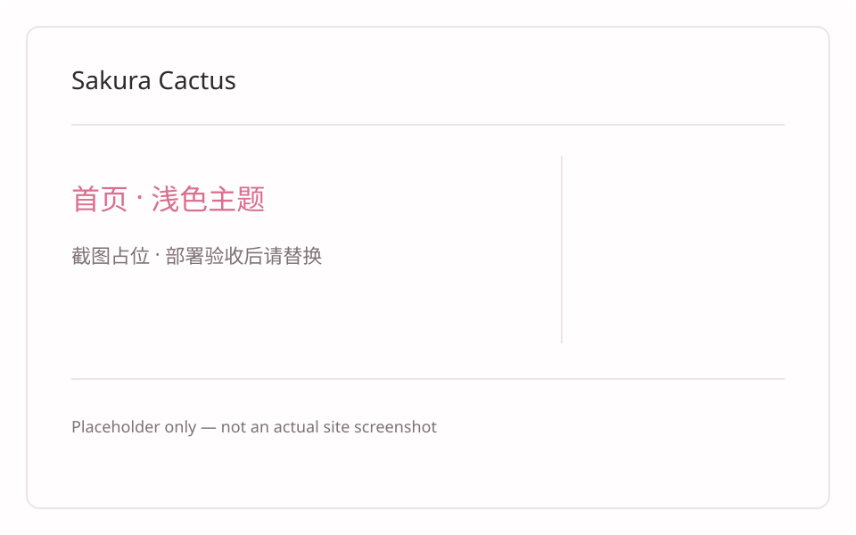
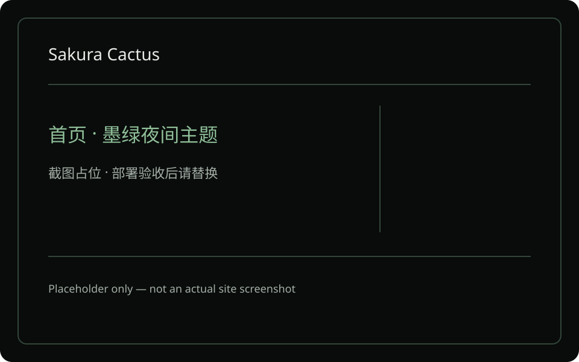
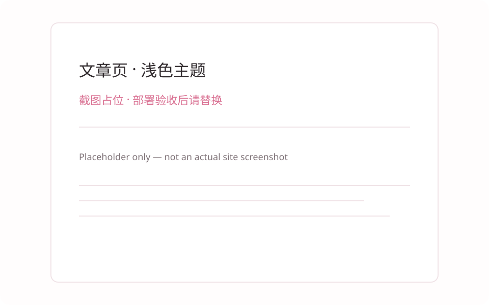
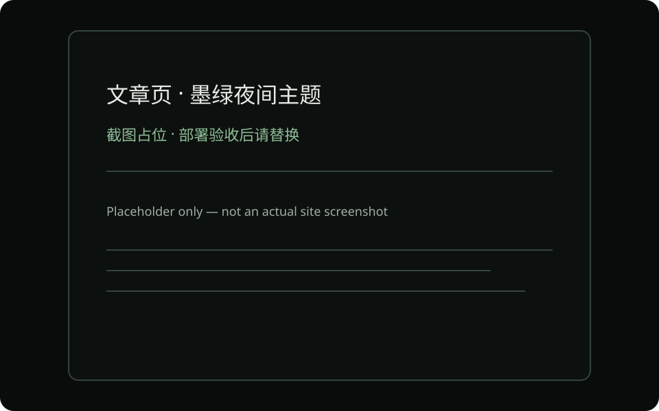

# Sakura Cactus

Sakura Cactus 是一个基于 Astro 和 Cloudflare Workers 的个人博客系统，适合用于文章、笔记、随笔和长期记录。后台只供博客所有者本人登录，不提供访客注册或多管理员体系。项目使用 Cloudflare D1 保存已发表内容与设置，使用 Cloudflare R2 保存图片和媒体文件。

演示站：[演示链接占位，部署后请替换](https://example.com/)。这不是项目的真实演示地址。

以下图片为截图占位，请在部署验收后替换为真实截图；它们不代表当前站点的实际内容。

| 页面 | 浅色主题 | 深色主题 |
| --- | --- | --- |
| 首页 |  |  |
| 文章页 |  |  |

## 核心功能

- Markdown 写作后台，支持编辑、预览、本地自动暂存、恢复提示、正式发表、修订、置顶和永久删除
- 未发表内容只保存在当前浏览器 localStorage；服务端只保存 `published` 文章，不提供服务端草稿、撤回或归档状态
- `/settings/data` 提供博客数据文件导入导出：已发表文章与标签、用户选择的文章图片、approved 友链
- 公开博客页面，包含首页、文章列表、文章详情、标签、时间轴、搜索、关于页和友人帐
- Cloudflare D1 存储文章、标签、设置、友链、限流和会话等博客数据
- 私有 Cloudflare R2 管理图片和媒体文件，支持上传、粘贴、拖拽和复用，并通过 `/i/:token` 代理读取
- 站点设置、友链申请、友链健康检查、访问量开关和 favicon 外链
- [Waline](https://waline.js.org/) 评论入口，开启评论并配置外部 Waline 服务后显示，评论数据由外部 Waline 服务保存
- 支持 RSS、sitemap、robots、canonical、Open Graph 和结构化数据。
- 后台写请求严格同源校验、登录/上传/友链/浏览计数限流、SSRF 防护、安全响应头和私有响应 `no-store`
- 直接依赖已固定为精确版本，并与 `pnpm-lock.yaml` 保持一致
- 适配 Cloudflare Workers SSR 部署

## 技术栈

| 类型 | 技术 |
| --- | --- |
| Web 框架 | Astro |
| 交互组件 | React |
| 语言 | TypeScript |
| 运行环境 | Cloudflare Workers |
| 数据库 | Cloudflare D1 |
| 媒体存储 | Cloudflare R2 |
| 静态资源 | Cloudflare Workers Assets |
| Markdown | unified / remark / rehype |
| 样式 | Tailwind CSS / CSS |
| 包管理 | pnpm |

## 快速部署

1. Fork 项目。
2. 创建 D1 数据库，名称固定为 `sakura_blog_prod`。
3. 创建 R2 Bucket，名称固定为 `sakura-blog-media-prod`。
4. 在 Cloudflare Workers 中连接 GitHub。
5. 填写构建命令、部署命令和 Build variables。
6. 首次部署后，在 Cloudflare Dashboard 配置后台账号、密码和生产 `SITE_URL`。
7. 按需绑定自定义域名，并确认 `SITE_URL` 是最终的完整 HTTPS 地址。
8. 重新部署并访问 `/admin/login`。

Build command：

```bash
pnpm install --frozen-lockfile && node scripts/prepare-cloudflare-config.mjs && pnpm build
```

Deploy command：

```bash
npx wrangler deploy
```

Build variables：

```env
SAKURA_D1_DATABASE_ID=你的 D1 Database ID
SAKURA_R2_BUCKET_NAME=sakura-blog-media-prod
```

两项都选择“文本”。

构建脚本会自动生成 D1 和 R2 bindings，不需要在运行时变量中手动添加 `DB` 或 `MEDIA_BUCKET`。D1 初始化和升级必须显式执行 `migrations/`；R2 Bucket 应保持私有，图片通过 `/i/:token` 代理访问，不需要为 R2 配置公开自定义域名。

## 环境变量

Cloudflare 中的变量值都会以字符串形式提供给 Worker。普通配置选择“文本（Text）”，密码等敏感内容选择“密钥（Secret）”。

| 名称 | 填写位置 | 必填 | 保存方式 | 说明 |
| --- | --- | --- | --- | --- |
| `SAKURA_D1_DATABASE_ID` | Git 构建设置中的 Build variables | 是 | 文本（Text） | D1 Database ID，用于构建时生成绑定 |
| `SAKURA_R2_BUCKET_NAME` | Git 构建设置中的 Build variables | 是 | 文本（Text） | R2 Bucket 名称，固定填写 `sakura-blog-media-prod` |
| `ADMIN_USERNAME` | Worker → 设置 → 变量和密钥 | 是 | 文本（Text） | 博客所有者的唯一管理员登录账号 |
| `ADMIN_PASSWORD` | Worker → 设置 → 变量和密钥 | 是 | 密钥（Secret） | 博客所有者的唯一管理员登录密码 |
| `SESSION_SECRET` | Worker → 设置 → 变量和密钥 | 否 | 密钥（Secret） | 可选高级配置；至少 32 字符，用于将会话密钥与登录密码分离 |
| `SITE_URL` | Worker → 设置 → 变量和密钥 | 生产必填 | 文本（Text） | 完整 HTTPS 站点地址，例如 `https://blog.example.com`；路径、查询参数和片段会被丢弃，只使用 origin |
| `SITE_NAME` | Worker → 设置 → 变量和密钥 | 否 | 文本（Text） | 站点名称 |
| `SITE_TAGLINE` | Worker → 设置 → 变量和密钥 | 否 | 文本（Text） | 首页标语 |
| `SITE_DESCRIPTION` | Worker → 设置 → 变量和密钥 | 否 | 文本（Text） | 站点描述 |
| `SITE_AVATAR_URL` | Worker → 设置 → 变量和密钥 | 否 | 文本（Text） | 登录后 Header 头像地址 |
| `SITE_TIMEZONE` | Worker → 设置 → 变量和密钥 | 否 | 文本（Text） | 站点日期、日历、归档和月度统计使用的 IANA 时区，默认 `Asia/Shanghai`；非法值回退并记录一次警告 |
| `SITE_GITHUB_URL` | Worker → 设置 → 变量和密钥 | 否 | 文本（Text） | 页脚 GitHub 个人链接，仅接受安全的公开 HTTPS 地址；未配置或非法时不显示图标 |
| `SITE_BILIBILI_URL` | Worker → 设置 → 变量和密钥 | 否 | 文本（Text） | 页脚 Bilibili 个人链接，仅接受安全的公开 HTTPS 地址；未配置或非法时不显示图标 |
| `SITE_OG_IMAGE_URL` | Worker → 设置 → 变量和密钥 | 否 | 文本（Text） | 首页、列表和无封面文章的默认分享图，仅接受安全的公开 HTTPS 地址；未配置时不额外输出图片 |
| `PUBLIC_COMMENTS_SERVER_URL` | Worker → 设置 → 变量和密钥 | 否 | 文本（Text） | 自己部署的 Waline 服务端地址 |

## 唯一管理员登录

`ADMIN_USERNAME` 和 `ADMIN_PASSWORD` 是唯一管理员凭据来源。推荐直接在 Cloudflare Dashboard 中将前者保存为 Text、后者保存为 Secret；命令行不是必需步骤。博客所有者在 `/admin/login` 输入的就是自己在 Dashboard 设置的同一组账号和密码，不需要手动生成密码哈希，也不需要在 D1 中创建管理员账号。

登录成功后，Worker 会确保 D1 中存在固定的 `env_admin` 技术占位记录，再创建 D1 会话。该记录只用于满足 `sessions.user_id` 与 `users.id` 的关系，不保存真实管理员账号、密码或可用于登录的凭据，也不是第二套登录来源。D1 仍负责文章、标签、设置、友链、限流、会话及其他现有博客数据；不要删除 D1、`users`/`sessions` 表或 migrations。

`SESSION_SECRET` 是可选高级配置。有效且至少 32 字符时会优先用于保护会话；未配置时，程序会继续从 `ADMIN_PASSWORD` 派生会话密钥，不影响正常登录。

生产环境必须配置 `SITE_URL`，而且必须是完整的 HTTPS 绝对地址。配置值会规范化为 origin；缺失、相对地址、无法解析的地址、非 HTTPS 生产地址或不支持的协议会触发清晰的配置错误。本地开发未配置时使用 `http://localhost:4321`；开发模式可以显式使用其他本地 HTTP 地址。

## 本地开发

```bash
pnpm install
pnpm dev
pnpm build
```

Windows PowerShell：

```bash
pnpm.cmd dev
pnpm.cmd build
```

常用检查：

```bash
pnpm.cmd exec tsc --noEmit --pretty false
pnpm.cmd check
pnpm.cmd test:security
pnpm.cmd build
pnpm.cmd audit --prod --registry=https://registry.npmjs.org/
```

在 Windows 沙箱或受限用户目录中运行 `pnpm.cmd check` / `pnpm.cmd build` 时，可将 Wrangler 配置目录指向项目内已忽略的本地目录：

```powershell
$env:XDG_CONFIG_HOME='D:\code\Sakura-Cactus\.wrangler-config'
$env:ASTRO_TELEMETRY_DISABLED='1'
pnpm.cmd check
pnpm.cmd build
```

## 持续集成

`.github/workflows/ci.yml` 在推送到 `main` 或提交 Pull Request 时运行。CI 使用 Node 22，并从 `package.json` 的 `packageManager` 读取精确 pnpm 版本，执行冻结锁文件安装、TypeScript 检查、Astro 检查、全部 `test:*` 脚本和最终构建。

CI 仅使用 `SAKURA_D1_DATABASE_ID=ci-placeholder` 生成本地测试绑定，不需要生产密钥或真实云资源。`test:d1` 会启动构建后的 `dist/server/wrangler.json`，所以在该测试之前额外预构建一次；测试完成后仍执行最终构建。生成的 `wrangler.jsonc` 仅存在于临时 CI 工作区，不会被提交或部署。

## 项目文档

- [架构与模块边界](./docs/ARCHITECTURE.md)
- [部署说明](./docs/DEPLOYMENT.md)
- [安全核对清单](./docs/SECURITY_CHECKLIST.md)
- [安全审计记录](./docs/SECURITY_AUDIT_REPORT.md)
- [历史最终复核](./docs/FINAL_REVIEW.md)
- [后续计划](./docs/TODO.md)
- [开发进度记录](./docs/AI_PROGRESS.md)
- [博客数据文件格式](./docs/BLOG_DATA_FORMAT.md)
- [项目数据审查](./docs/PROJECT_DATA_AUDIT.md)

## 安全说明

- 不提交 `.env` 和 `.dev.vars`
- 不提交密码、Token 或密钥
- 博客所有者的唯一管理员登录密码使用 Cloudflare“密钥（Secret）”
- 博客所有者的唯一管理员登录账号使用 Cloudflare“文本（Text）”
- 生产 `SITE_URL` 必须使用完整 HTTPS 地址
- R2 Bucket 保持私有
- D1/R2 生产资源、缓存规则、备份和 Secret 状态需要在 Cloudflare 控制台确认
- 公开页面在写操作成功后使用 Cache API 清除缓存。Cloudflare `caches.default` 按数据中心独立存储，失效只影响当前数据中心；其他地区仍在原 TTL 到期后更新，不等同于 Cloudflare 全网 CDN purge。缓存失效失败会记录日志，不会撤销已经成功的写操作。
- 当前生产依赖审计保留 1 个已知低危 Babel 传递依赖告警，等待上游发布可用修复版本

## 计划功能

- Versioned blog export
- Validated blog import
- Backup preview, dry-run, and conflict resolution

## 致谢

感谢 Astro、Cloudflare Workers、Cloudflare D1、Cloudflare R2、React、unified 生态和 Waline 等项目与平台。

Sakura Cactus 是独立开发的开源项目，与 Astro、Cloudflare 及上述项目不存在官方隶属、合作或背书关系。

## License

本项目基于 [MIT License](./LICENSE) 开源。
